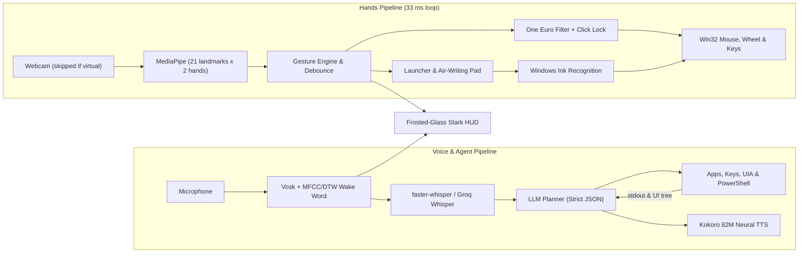

<div align="center">



<h1>ZEHEN — Open-Source Tony Stark &amp; J.A.R.V.I.S. Control for Windows</h1>

**Turn any Windows laptop webcam and microphone into a Tony Stark–style HUD: hand-gesture virtual mouse, air-writing, and an offline-capable J.A.R.V.I.S. AI desktop agent in one open-source Python file.**

[](https://github.com/priyanshusta/ZEHEN/stargazers)
[](https://github.com/priyanshusta/ZEHEN/network/members)
[](LICENSE)


[](https://medium.com/ai-decode/10-crazy-github-projects-that-turn-your-devices-into-computer-controllers-778b1c478d78)

[Website](https://priyanshusta.github.io/ZEHEN/) &nbsp;|&nbsp; [Quick Start](#quick-start) &nbsp;|&nbsp; [Why ZEHEN](#why-zehen) &nbsp;|&nbsp; [Gestures](#hand-gestures-webcam-virtual-mouse) &nbsp;|&nbsp; [Voice Agent](#voice--ai-desktop-agent) &nbsp;|&nbsp; [Architecture](#architecture) &nbsp;|&nbsp; [Privacy](#privacy--security) &nbsp;|&nbsp; [FAQ](#faq) &nbsp;|&nbsp; [Roadmap](ROADMAP.md)

<br>

<a href="https://priyanshusta.github.io/ZEHEN/#demo"></a>

<sub>Recorded on a standard laptop webcam with WinScreen Studio. <a href="https://priyanshusta.github.io/ZEHEN/#demo">Watch the 1080p video</a>.</sub>

</div>

<br>

## Overview

**ZEHEN** is a free, open-source **J.A.R.V.I.S. / Iron Man–inspired desktop interface for Windows 10 and Windows 11**. It turns an ordinary laptop webcam into a precision **hand-gesture virtual mouse** and an ordinary microphone into an **AI desktop agent** — with no gloves, no depth camera, and no extra hardware.

Using MediaPipe to track **21 landmarks per hand across both hands**, ZEHEN filters out hand jitter with a One Euro filter and drives Windows natively: cursor movement, pinch clicks, drag-and-drop, two-finger scrolling, two-hand stretch zoom, app switching, a translucent launcher, and mid-air handwriting converted via Windows ink recognition. Say **"Zehen"** and **Noor** (the built-in voice agent) takes over: transcribing locally with `faster-whisper` (~0.4 s), planning multi-step actions via **Windows UI Automation** and **PowerShell**, and speaking back through an offline **Kokoro 82M** neural voice.

> Featured at **#9 on Medium** in [*"10 Crazy GitHub Projects That Turn Your Devices Into Computer Controllers"*](https://medium.com/ai-decode/10-crazy-github-projects-that-turn-your-devices-into-computer-controllers-778b1c478d78).

<table>
<tr>
<td width="33%" valign="top">

**Webcam Virtual Mouse**

Point to move, pinch to click or drag, double-pinch to open, two fingers to scroll, both hands to zoom, swipe to switch apps, three fingers to write in the air. One Euro smoothing and click-lock keep cursor targeting steady, and touching your real mouse yields control immediately.

</td>
<td width="33%" valign="top">

**J.A.R.V.I.S. Voice &amp; Computer Use**

One offline wake word, then plain language. The agent inspects clickable UI controls by name via Windows UI Automation, opens apps, types, runs PowerShell, reads command output, and loops up to 6 steps until done. Common commands run locally in milliseconds with zero LLM calls.

</td>
<td width="33%" valign="top">

**Frosted-Glass Stark HUD**

A small Windows acrylic pill displays live hand state, wake waveform, and spoken captions. Point at the pill to expand the full panel, or switch to voice-only mode with a single click or `"turn off the camera"` — turning the physical webcam stream off completely.

</td>
</tr>
</table>

## Why ZEHEN

Most open-source "Jarvis" repositories are keyword `if/elif` scripts using robotic `pyttsx3` voices, and most "virtual mouse" repositories are raw 50-line OpenCV demos with jittery cursors and constant misclicks. ZEHEN combines real HCI smoothing with a genuine multi-step desktop agent in a single file ([`zehen.py`](zehen.py)).

| Capability | ZEHEN | Typical Python "Jarvis" Scripts | Basic OpenCV Virtual Mouse |
|---|---|---|---|
| **Hand tracking &amp; cursor feel** | 21-point MediaPipe × 2 hands, One Euro filter, pinch click-lock, gesture debounce, yields to real mouse | None | Raw landmarks, cursor jitter, frequent false clicks |
| **Desktop automation (Computer Use)** | Multi-step AI agent via Windows UI Automation (`ui_list`, `click` by control name) + PowerShell | Hardcoded `if/elif` commands or basic `webbrowser` calls | Cursor movement only |
| **Wake word &amp; hearing** | On-device MFCC + DTW voice enrollment (3 samples) + local `faster-whisper` (~0.4 s) + Vosk backup | Cloud-only STT or noisy keyword triggers | None |
| **Spoken replies** | Offline Kokoro 82M (`int8`) neural TTS | Robotic `pyttsx3` system voice | None |
| **AI brain flexibility** | Free cloud (Groq, Gemini, OpenRouter, OpenAI, custom/Ollama) **or** offline Qwen3 1.7B via `llama.cpp` | Single paid OpenAI key hardcoded | None |
| **Setup &amp; footprint** | Single file `zehen.py`, automatic first-run checklist (`~0.7 GB` RAM), MIT license | Fragile manual dependencies | Toy script |

## Quick Start

**Requirements:** Windows 10 or Windows 11, Python 3.10 or newer, a webcam, and a microphone.

```bash
git clone https://github.com/priyanshusta/ZEHEN.git
cd ZEHEN
.\ZEHEN.bat
```

`ZEHEN.bat` locates Python (even if it is not on `PATH`), installs dependencies on first run, and launches ZEHEN in the background. On first start, a **setup checklist** downloads only missing components with live progress bars, walks you through each gesture out loud, and records three samples of your voice saying `"Zehen"` so it wakes reliably for your accent.

- Run `python zehen.py --setup` to trigger the dependency/model checklist from a terminal (or say `"run setup"`).
- Run `python zehen.py --test` to execute the built-in self-test suite without a camera.
- Run [`build.bat`](build.bat) to bundle a standalone `dist\ZEHEN.exe` via PyInstaller (requires ~3 GB free disk space while building).

Models are stored locally in `%USERPROFILE%\.zehen`:

| Component | Size | Role | License |
|---|---|---|---|
| MediaPipe Hand Landmarker | 8 MB | 21-point two-hand tracking on CPU | Apache-2.0 |
| Vosk small English (`en-us`) | 40 MB | Offline wake word &amp; backup speech recognition | Apache-2.0 |
| Whisper `base.en` (`faster-whisper`) | 145 MB | Local speech-to-text (~0.4 s on CPU, accent-tolerant) | MIT |
| Kokoro 82M (`int8` ONNX) | 120 MB | Offline neural text-to-speech voice | Apache-2.0 |
| Qwen3 1.7B (`Q4_K_M`, optional) | 1.1 GB | Fully offline AI planning via `llama.cpp` when no cloud key is set | Apache-2.0 |

## Hand Gestures (Webcam Virtual Mouse)

| Gesture | Action | Notes |
|---|---|---|
| **Index finger up** | Move cursor | Smoothed via One Euro filter; cursor freezes briefly on pinch so clicks land accurately |
| **Pinch (thumb + index)** | Left-click / drag | Quick tap clicks; hold to drag files or windows |
| **Pinch twice quickly** | Double-click / open | Opens apps, files, and folders |
| **Index up + thumb to middle finger** | Right-click | Opens context menus |
| **Two fingers up** | Scroll | Raise hand to scroll up, lower to scroll down |
| **Open palm, hold** | App &amp; window launcher | Shows running windows, favorite apps, full Start menu search, and system controls |
| **Three fingers, hold** | Air-writing pad | Write in the air; Windows offline ink recognition types into the active window |
| **Both hands pinch, then stretch** | Zoom in / out | Spread apart to zoom in, bring together to zoom out |
| **Other hand swipe** | Switch app | Quick sideways wave jumps between recent windows |
| **Fist** | Pause | Halts gesture input and interrupts running voice steps |

The right hand controls the cursor by default and the left issues two-hand commands (set `"main_hand": "Left"` in `.zehen.json` for left-handed control). Either hand works solo. Touching your physical mouse or touchpad yields cursor control immediately, and pointing at the HUD pill expands the full panel.

## Voice &amp; AI Desktop Agent

After ZEHEN greets you, say **"Zehen"** at the start of a phrase followed by a plain-language request:

```text
"Zehen, open Spotify."
"Zehen, search for flights to Goa on Edge."
"Zehen, what is using my CPU?"
"Zehen, move everything in Downloads older than a month to D drive."
"Zehen, open Notepad and write a shopping list."
```

### How a Request Executes

1. **Wake.** During onboarding, ZEHEN learns three samples of *your* voice saying `"Zehen"` using on-device MFCC + dynamic time warping, paired with Vosk. The wake word only triggers at the start of an utterance, so ordinary conversation (`"that is insane"`) does not wake it.
2. **Hear.** Your request is transcribed locally by `faster-whisper` (`~0.4 s`, seeded with open window/app names so terms like `"Jupyter"` stay accurate). If you use a Groq key, Groq's Whisper endpoint is used automatically. Vosk serves as a backup transcript to recover common mishearings (`"like"` → `"click"`).
3. **Plan.** The language model responds with strict JSON actions; anything outside the supported action schema is discarded.
4. **Act.** Opens apps, focuses windows or browser tabs by name, opens URLs, runs web searches, types text, triggers keyboard shortcuts, adjusts volume/media, clicks UI elements by accessible name, and executes PowerShell.
5. **Look.** PowerShell stdout and accessible UI control lists are fed back to the model so it can verify progress and continue (up to 6 steps per request).
6. **Answer.** Noor speaks the outcome aloud via Kokoro 82M, retains recent conversation context, and listens briefly for a follow-up reply without repeating the wake word.

### Built-In Capabilities

- **Video playback:** Say `"play the first video"`, `"play the third one"`, or `"play lo-fi beats on YouTube"`. ZEHEN inspects visible browser controls via UI Automation, skips ads, and launches the matching video (or searches YouTube when the title is not on screen).
- **Voice dictation:** Say `"click on the search bar"` (or `"message box"`, `"address bar"`). ZEHEN focuses the field, says `"Ready to type."`, and dictates with punctuation and capitalization until you say `"send"` or `"stop typing"`.
- **Instant zero-AI commands:** `"scroll down"`, `"scroll up a lot"`, `"click"`, `"double click"`, `"right click"`, `"go back"`, `"new tab"`, `"copy"`, `"paste"`, `"zoom in"`, `"volume down"`, `"pause"`, `"close window"`, `"type hello"`, `"search for flights"`, `"open YouTube"`, and chains joined by `"and"` or `"then"` execute locally in milliseconds without calling an LLM.
- **Voice-only mode:** Say `"turn off the camera"` or click `CAM` on the HUD panel to shut down the camera completely while keeping voice control active. Say `"learn my voice"` anytime to re-enroll the wake word.
- **UI Automation without vision models:** Clicking inside apps reads Windows UI Automation control trees (buttons, tabs, text fields, list items) as text — avoiding screenshot capture or VRAM-heavy vision models. Unlabeled graphics or apps without accessibility trees fall back to keyboard shortcuts.

### Choose Your AI Brain (Cloud, Local Server, or Built-In Offline)

| | Cloud or Local API Key (`llm`) | Built-In Offline Brain |
|---|---|---|
| **Setup** | HUD Panel → `Get key` → `Paste key` (or set `ZEHEN_API_KEY`) | Automatic one-time download (1.1 GB) |
| **Supported Providers** | **Groq** (`openai/gpt-oss-120b`), **Gemini** (`gemini-flash-latest`), **OpenRouter** (`openrouter/free`), **OpenAI** (`gpt-4o-mini`), or **Custom** OpenAI-compatible (e.g., **Ollama**, **LM Studio**) | **Qwen3 1.7B** (`Q4_K_M`) via `llama.cpp` on CPU |
| **Speed &amp; Reasoning** | Fast multi-step planning and complex PowerShell | Slower, tuned for simpler tasks |
| **Cost** | Free tiers available on Groq, Gemini, and OpenRouter | Free forever, zero rate limits |
| **Data Leaving PC** | Spoken text after wake word, window/app names, and tool outputs | Nothing leaves your PC |

API key prefixes (`gsk_` for Groq, `AIza` for Gemini, `sk-or-` for OpenRouter, `sk-` for OpenAI) are auto-detected and verified on entry. If a cloud key expires or hits a rate limit, ZEHEN falls back cleanly to the offline brain.

> **Safety guardrails:** ZEHEN's built-in safety firewall (`audit_action_safety`) blocks catastrophic commands (disk formatting, deleting `C:\Windows` / `System32` / user directories, or disabling Windows Defender) and requires explicit spoken confirmation (`"confirm"` / `"cancel"`) before destructive actions such as deleting files, terminating processes, emptying the Recycle Bin, or shutting down. Standard PowerShell and UI actions run under your Windows user account; make a **fist** (or press Pause on the HUD) to halt between steps, or set `"voice": false` in `.zehen.json` to disable voice input completely.

## Architecture



The entire application lives in a single readable file, [`zehen.py`](zehen.py):
- Camera tracking runs on a background thread and publishes an immutable frame snapshot; the Tkinter acrylic HUD only renders state.
- Voice capture, transcription, planning, and TTS run asynchronously on dedicated threads.
- Every sensitivity threshold, smoothing coefficient, and timing constant is documented at the top of `zehen.py`.

## Configuration

Settings live in `%USERPROFILE%\.zehen.json`:

| Key | Default | Purpose |
|---|---|---|
| `main_hand` | `"Right"` | Primary hand that drives the cursor (`"Right"` or `"Left"`) |
| `apps` | Built-in list | Launcher favorites matched by Start menu name |
| `camera` | Auto | Camera index; ZEHEN automatically skips virtual cameras (OBS, PRISM) |
| `tutorial_done` | `false` | Set to `false` to replay the guided onboarding tutorial |
| `voice` | `true` | Set to `false` to disable the microphone and voice assistant entirely |
| `camera_on` | `true` | `false` activates voice-only mode (`CAM` button or `"turn off the camera"`) |
| `tutorial_voice` | `true` | Set to `false` to mute voice narration during the tutorial |
| `brain_setup` | `true` | Set to `false` to skip downloading the offline Qwen3 model on first run |
| `no_follow_up` | `false` | Set to `true` to require `"Zehen"` before every follow-up reply |
| `greeting` | `true` | Set to `false` to disable the startup voice greeting |
| `wake` | `["zane"]` | Fallback wake spellings used before voice enrollment completes |
| `stt_model` | `"base.en"` | Local Whisper size (`tiny.en` for speed, `small.en` at 480 MB for higher accuracy) |
| `voice_name` | `"af_heart"` | Kokoro voice (`af_bella`, `af_nicole`, `af_sarah`, `af_sky`, `bf_emma`) |
| `llm` | None | `{ "api_key", "base_url", "model" }` for cloud APIs or local OpenAI-compatible servers |

## Privacy &amp; Security

- **Zero camera persistence:** Frames are processed strictly in RAM and discarded immediately. Video is never displayed, saved, or uploaded.
- **Local wake word:** Microphone audio is buffered only on your machine and only transcribed after the wake word fires. Audio leaves your PC only if you supply a Groq key (using Groq Whisper).
- **Offline or BYO LLM:** With the local Qwen3 1.7B model (or a local Ollama/LM Studio server via `llm`), zero data leaves your computer. With cloud keys, requests and active window names are sent only to your chosen provider.
- **Plain-text local config:** API keys in `.zehen.json` are stored locally; no accounts, telemetry, analytics, or ads exist anywhere in ZEHEN.

Report vulnerabilities or review full security guidelines in [SECURITY.md](SECURITY.md).

## Requirements &amp; Performance

| Resource | Requirement / Typical Usage |
|---|---|
| **OS** | Windows 10 or Windows 11 (x64) |
| **Memory** | ~0.7 GB RAM with camera tracking, Whisper, Vosk, and Kokoro loaded |
| **Disk** | ~0.3 GB base models (+1.1 GB optional offline Qwen3 1.7B model) |
| **CPU** | Any modern laptop CPU — runs at native camera frame rate (~33 ms loop) without a GPU |
| **Network** | First-run dependency/model download and optional cloud LLM inference |

## FAQ

<details>
<summary><b>Is ZEHEN a free, open-source Tony Stark / J.A.R.V.I.S. for Windows?</b></summary>
<br>
Yes. ZEHEN is MIT-licensed, completely free with no paid tier or account, and inspired by Tony Stark's J.A.R.V.I.S. and holographic HUD. You can control the cursor with hand gestures through your webcam and command Windows by voice with local or free cloud AI planning.
</details>

<details>
<summary><b>Can I control my computer as a webcam virtual mouse without gloves or Leap Motion?</b></summary>
<br>
Yes. ZEHEN uses MediaPipe to track 21 landmarks per hand from any standard laptop or USB webcam and drives the real Windows mouse cursor, clicks, dragging, scrolling, zoom, app switching, and air-writing. No gloves, IR sensors, or depth cameras are required.
</details>

<details>
<summary><b>Does ZEHEN work offline with a local LLM or Ollama?</b></summary>
<br>
Yes. Hand tracking, handwriting recognition, wake-word detection, local speech-to-text (<code>faster-whisper</code>), neural TTS (Kokoro 82M), and planning (via the built-in 1.1 GB Qwen3 1.7B model) all run 100% offline. You can also point the <code>llm</code> config at any local OpenAI-compatible server such as Ollama or LM Studio.
</details>

<details>
<summary><b>How does ZEHEN click inside apps without screenshots or a vision model?</b></summary>
<br>
ZEHEN reads Windows UI Automation trees to discover buttons, tabs, text fields, and list items by accessible name in plain text, keeping memory usage near 0.7 GB without running a multimodal vision model.
</details>

<details>
<summary><b>Is ZEHEN really free and private?</b></summary>
<br>
Yes. Camera frames are never saved, shown, or uploaded. All telemetry, ads, and accounts are absent. Using the offline Qwen3 model keeps 100% of voice and system context on your device.
</details>

<details>
<summary><b>It does not wake when I say "Zehen" — how do I fix it?</b></summary>
<br>
Run voice enrollment (say <code>"learn my voice"</code>) so ZEHEN matches your personal three-sample MFCC profile, and speak <code>"Zehen"</code> at the start of a phrase rather than mid-sentence. Before enrollment, you can also add phonetic spellings to <code>wake</code> in <code>.zehen.json</code>.
</details>

<details>
<summary><b>Does ZEHEN work on macOS or Linux?</b></summary>
<br>
Not yet. Window automation, Start menu lookup, Windows ink handwriting recognition, and UI Automation are currently Windows-specific. Cross-platform support is tracked in the <a href="ROADMAP.md">roadmap</a>.
</details>

## Contributing, Roadmap &amp; License

- [ROADMAP.md](ROADMAP.md) — Mark I through v1.0 Stark vision (calibration, custom gestures, multi-monitor, AR/holo-table).
- [CONTRIBUTING.md](CONTRIBUTING.md) — Dev setup, architecture map, and pull request checklist.
- [CHANGELOG.md](CHANGELOG.md) — Release notes and development history.
- [SECURITY.md](SECURITY.md) — Local execution risks and responsible disclosure.
- [MIT License](LICENSE) — Permissive open-source license.

If ZEHEN inspired an experiment or saved you clicks, star the repository to help more Windows users find it, or [fork ZEHEN](https://github.com/priyanshusta/ZEHEN/fork) to add custom gestures, HUD widgets, or macOS/Linux support.

## Acknowledgements

[MediaPipe](https://github.com/google-ai-edge/mediapipe) (hand landmarks), [Vosk](https://alphacephei.com/vosk/) (offline wake word), [faster-whisper](https://github.com/SYSTRAN/faster-whisper) (local speech-to-text), [Kokoro](https://github.com/hexgrad/kokoro) &amp; [kokoro-onnx](https://github.com/thewh1teagle/kokoro-onnx) (offline neural voice), [Qwen3](https://github.com/QwenLM/Qwen3) &amp; [llama.cpp](https://github.com/ggml-org/llama.cpp) (local CPU inference), [Python-UIAutomation-for-Windows](https://github.com/yinkaisheng/Python-UIAutomation-for-Windows) (accessible UI control), and the One Euro filter by Casiez, Roussel, and Vogel.

<div align="center">
<sub>Created by <a href="https://github.com/priyanshusta">@priyanshusta</a> · <a href="LICENSE">MIT License</a></sub>
</div>
